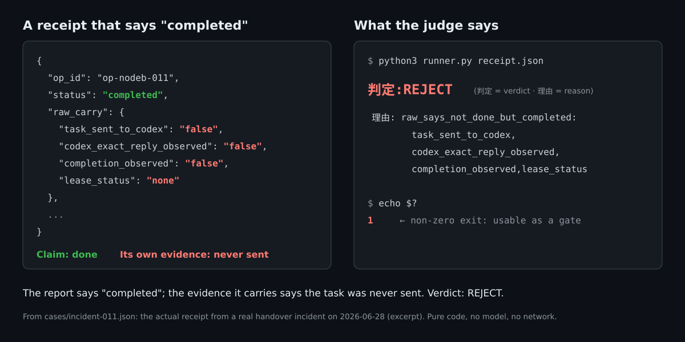

# Handover Receipt Judge

**Your agent says "done". Find out in one second whether its own evidence agrees.**

[中文](README.md)

One of the nastiest failures in agent handovers: the status says `completed`, while the evidence carried in the very same receipt says the task was never sent. We lost four hours to exactly this. The picture below is that incident, as it happened.



This tool does one thing: it reads a "completed" report and checks whether it contradicts the evidence it carries. Pure code, no model calls, no network, one command to run.

It does **not** judge whether the work is correct. It only judges whether the report is consistent with itself (see "What it judges and what it does not").

## Quick start

All you need is Python 3. No pip, no network, no API key: the judge uses only the standard library.

```sh
git clone https://github.com/xie374059-sys/receipt-v1.git
cd receipt-v1
python3 runner.py
```

With no arguments it runs every suite under `cases/` and prints a scorecard per suite. Everything should be green.

Seeing `REJECT` inside those suites is expected. Catching false completions is the whole point: a gate that always says yes is worse than no gate.

## Judge your own receipt

```sh
# judge one receipt (format: the seven fields in spec.md)
python3 runner.py my-receipt.json

# machine-readable output, for CI
python3 runner.py my-receipt.json --json

# run one suite
python3 runner.py --suite cases/generic-suite.json
python3 runner.py --suite cases/incident-011.json
```

The output is one of **ACCEPT / REJECT / NEEDS_HUMAN**, plus the rule that fired. The same receipt gives the same verdict no matter who runs it.

Command-line labels are in Chinese (`判定` = verdict, `理由` = reason). Rule names are English identifiers, and `--json` uses English keys (`verdict`, `reasons`, `missing_fields`) plus a plain-language explanation in Chinese under `人话`.

## Exit codes

| Verdict | Exit code |
|---|---|
| `ACCEPT` | 0 |
| `REJECT` | 1 |
| `NEEDS_HUMAN` | 1 |

"Cannot decide" does not count as a pass. `--json` uses the same exit codes, so it can be used as a merge gate:

```bash
python3 runner.py my-receipt.json --json || { echo "receipt rejected"; exit 1; }
```

If you want the JSON and never a failing exit (for example when using it as a library), add the flag `--不闸` ("no gate"), which always returns 0.

## What it catches

Seven kinds of false completion, one per field:

| Field | The false completion it catches |
|---|---|
| `op_id` | The same job dispatched twice and done twice |
| `attempts` | A retry sent under a new id, defeating idempotency |
| `status` | A state machine treating "receipt received" as "done" |
| `evidence_level` | Marked completed without verification |
| `capability_gap` | A known gap, yet marked completed |
| `raw_carry` | Original values reformatted or rewritten locally, so they no longer match |
| `formal_ack` | The worker announcing "I am done" on its own authority |

Field definitions and the judging rules are in [`spec.md`](spec.md) (Chinese).

## What it judges and what it does not

```
It judges         whether your claim contradicts the evidence you handed in
It does not judge whether the work is right, whether the answer is right,
                  or whether it should have been done this way
```

**Consistent is not the same as correct.** A receipt can be perfectly consistent and still describe wrong work, and it will pass. That is deliberate: a tool that only compares can be checked by anyone, and the price is that it cannot see beyond the comparison. That limit is stated here, not hidden.

## Boundaries

- It does not define identity, credentials or transport. Those belong to MCP, A2A and GB/Z 185.
- It does not explain why a decision was made. A receipt records facts, not reasons.
- It never produces a formal acknowledgement.
- It does not replace observability. Logs are for people to read; receipts are for machines to judge, and this one blocks.
- It does not judge whether the answer is correct, only whether the receipt is self-consistent.

More detail in [`边界.md`](边界.md) (Chinese).

## Where it came from

It grew out of a real incident. On 2026-06-28, during a cross-machine handover, the state machine said `completed` while the same receipt's `raw_carry` said `task_sent_to_codex=false` and `completion_observed=false`. The root cause was `lease_status=none`, and the job sat stuck for four hours. Both statements were present side by side, and nothing flagged the contradiction.

That incident ships with the package as `cases/incident-011.json`, built from the acceptance evidence of that day.

## Files

| File | What it is |
|---|---|
| `spec.md` | Field definitions, judging rules, and why there are seven fields |
| `runner.py` | The judge (pure code, no model calls) |
| `cases/generic-suite.json` | Generic adversarial scenarios, not tied to any industry |
| `cases/incident-011.json` | The real incident |
| `cases/op-id-suite.json` | Positive and negative cases for `op_id` and evidence-level rules |

To see how many cases each suite has, run `python3 runner.py`: the counts are printed on each line.

## Status

This is an early project by one person, working on the "can it be judged" half of agent handovers. It is meant to be run and picked apart, not depended on yet.

If you get stuck, or a sentence does not make sense, please open an issue and paste the step as it happened. That is worth far more than "works fine".

## License

MIT
